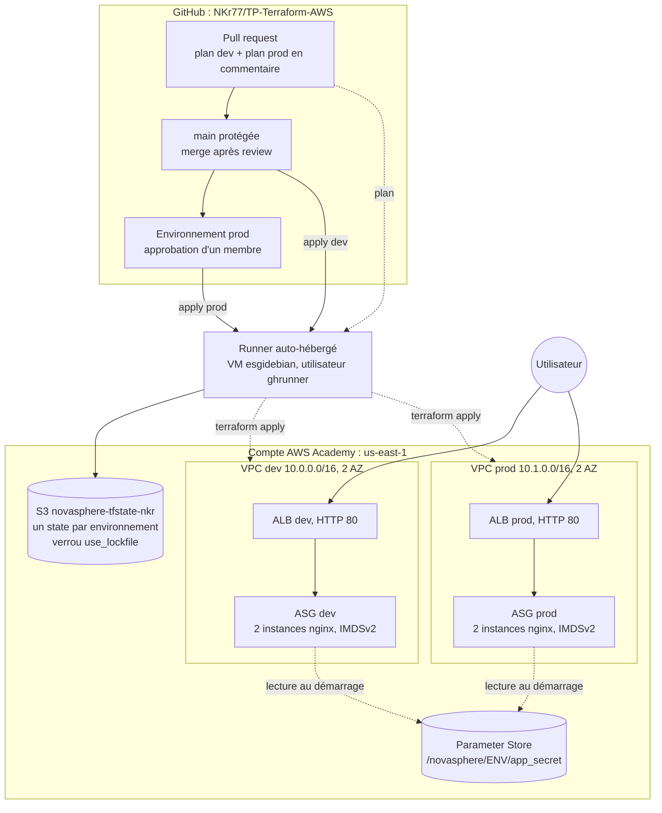

# Architecture NovaSphere

Deux environnements isolés, `dev` et `prod`, de structure identique. Ils partagent le code
(module `web` versionné par tag), pas le state. Tout changement passe par la chaîne GitHub Actions.

## Composants

| Brique | Réalisation |
|--------|-------------|
| Réseau | Module du registre `terraform-aws-modules/vpc/aws` (~> 6.0), 2 subnets publics sur 2 AZ, sans NAT Gateway |
| Application | Module `modules/web` (tag `web-v2.0.0`) : ALB, target group, Launch Template, ASG, Security Groups |
| Instances | Debian 12 (AMI figée), nginx installé par un amorçage de 9 lignes, IMDSv2 exigé, pas de SSH |
| Secret | `ephemeral random_password` écrit avec `value_wo` dans Parameter Store, lu par l'instance via son rôle |
| State | Bucket S3 versionné et chiffré, une clé par environnement, verrou natif `use_lockfile` |
| CI/CD | Workflows PR (plan en commentaire), Apply (dev au merge, prod après approbation), Drift, Destroy |

## Plan d'adressage

| Élément | dev | prod |
|---------|-----|------|
| VPC | 10.0.0.0/16 | 10.1.0.0/16 |
| Subnet us-east-1a | 10.0.1.0/24 | 10.1.1.0/24 |
| Subnet us-east-1b | 10.0.2.0/24 | 10.1.2.0/24 |
| ASG | min 2, max 4, souhaité 2 | min 2, max 4, souhaité 2 |
| Secret | `/novasphere/dev/app_secret` | `/novasphere/prod/app_secret` |
| State | `novasphere/dev/terraform.tfstate` | `novasphere/prod/terraform.tfstate` |

## Flux réseau

Internet → ALB (80) → instances (80, uniquement depuis le Security Group de l'ALB).
Sortie des instances : 80 et 443 (paquets Debian, API Parameter Store).

Le détail de nos choix est dans `DECISIONS.md`, les risques et les écarts assumés dans `SECURITE.md`.
